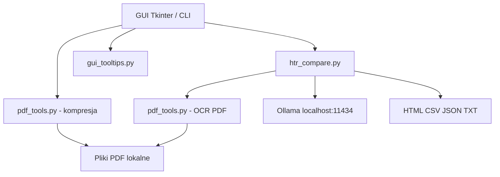

# Architektura projektu

## Główne moduły

| Plik | Odpowiedzialność |
| --- | --- |
| `htr_compare.py` | GUI Tkinter, CLI, integracja Ollama, segmentacja, OCR/HTR, porównanie, raporty, checkpoint. |
| `gui_tooltips.py` | Opisy kontrolek, opóźnione podpowiedzi po najechaniu i po uzyskaniu fokusu. |
| `pdf_tools.py` | Kompresja PDF, ponowne kodowanie obrazów, zapis niewidocznej warstwy Unicode. |
| `run.sh` | Uruchomienie aplikacji i przygotowanie środowiska Python. |
| `tests/` | Testy jednostkowe i integracyjne bez rzeczywistego modelu Ollama. |
| `docs/` + `mkdocs.yml` | Źródła dokumentacji MkDocs. |
| `.github/workflows/pages.yml` | Budowanie dokumentacji i publikacja przez GitHub Actions. |

## Granice systemu

## Ograniczenia

- Brak segmentacji pól odpowiedzi opartej na ich rzeczywistych granicach; używane są pasy poziome.
- Brak bounding boxów słów i wyrównywania tekstu do pikseli źródłowych.
- Niepełna obsługa niektórych typów obrazów PDF; nieobsługiwane obrazy pozostają niezmodyfikowane.
- Kontrola jakości HTR wymaga człowieka i danych referencyjnych.
- Brak samodzielnej diagnostyki skuteczności HTR na zbiorze prac studentów.

Dalszy rozwój można skierować na precyzyjne lokalizowanie odręcznych odpowiedzi, automatyczne wyrównanie stron i zestawy walidacyjne.
