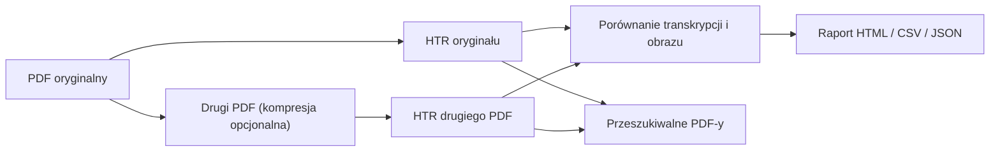

# HTR OCR PDF

**Wersja 1.2.1** · lokalne przetwarzanie plików PDF i rozpoznawanie pisma odręcznego.

## Funkcje

- Kompresja PDF: cztery profile, z zachowaniem zawartości wektorowej.
- Strumieniowe HTR przez lokalny model Ollama i możliwość przerwania generacji.
- Porównywanie tekstów i obrazów za pomocą metryk.
- Eksport HTML, CSV, JSON, TXT i przeszukiwalnych PDF-ów.
- Wznawianie analizy od ukończonych stron.

Zależności: Python, PyMuPDF, Pillow, Tkinter i lokalny Ollama z modelem Qwen3-VL.

## Dokumentacja techniczna

- [Instalacja](installation.md)
- [Interfejs graficzny](interface.md)
- [Kompresja PDF](compression.md)
- [HTR/OCR](recognition.md)
- [Formaty wynikowe](results.md)
- [Definicje metryk](evaluation.md)
- [Architektura](architecture.md)
- [Testowanie i publikacja](development.md)
- [Rozwiązywanie problemów](troubleshooting.md)

## Etapy przetwarzania

Źródła: [MatPomGit/htr-ocr-pdf](https://github.com/MatPomGit/htr-ocr-pdf).
