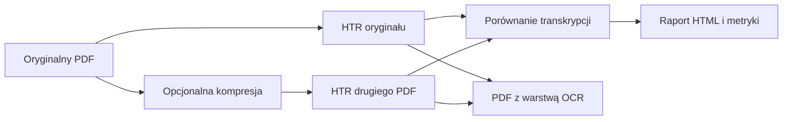

# HTR OCR PDF

**Wersja 1.2.0** · lokalny program badawczy do porównywania rozpoznawania pisma odręcznego w dwóch wersjach dokumentu PDF.

System umożliwia:

- samodzielną kompresję PDF w czterech profilach;
- transkrypcję odręcznych odpowiedzi tym samym lokalnym modelem multimodalnym;
- porównanie zmian wizualnych i tekstowych po kompresji;
- wyliczenie CER/WER przy użyciu transkrypcji wzorcowej;
- eksport raportu oraz PDF z niewidoczną, przeszukiwalną warstwą HTR.

Działa lokalnie na Pythonie, PyMuPDF i [Ollama](https://ollama.com/) z modelem Qwen3-VL. Nie wymaga płatnych usług ani wysyłania dokumentów studenckich do zewnętrznego API.

!!! warning "Przeznaczenie"
    To eksperymentalne narzędzie badawcze, a nie zwalidowany system automatycznego oceniania. Wyniki rozpoznawania powinny być sprawdzane przez człowieka. Mały błąd obrazu (np. RMSE) nie gwarantuje małego błędu HTR.

## Szybki start

```bash
git clone https://github.com/MatPomGit/htr-ocr-pdf.git
cd htr-ocr-pdf
./run.sh
```

Otworzy się interfejs graficzny. Wybierz oryginalny PDF, a następnie drugi PDF albo utwórz go przyciskiem kompresji. Najedź kursorem na elementy interfejsu, aby zobaczyć objaśnienia.

**Dalsze kroki:** [instalacja](installation.md), [obsługa GUI](interface.md), [przykładowy eksperyment](evaluation.md).

## Etapy przetwarzania



Kod i zgłaszanie problemów: [repozytorium GitHub](https://github.com/MatPomGit/htr-ocr-pdf).
